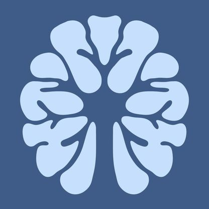
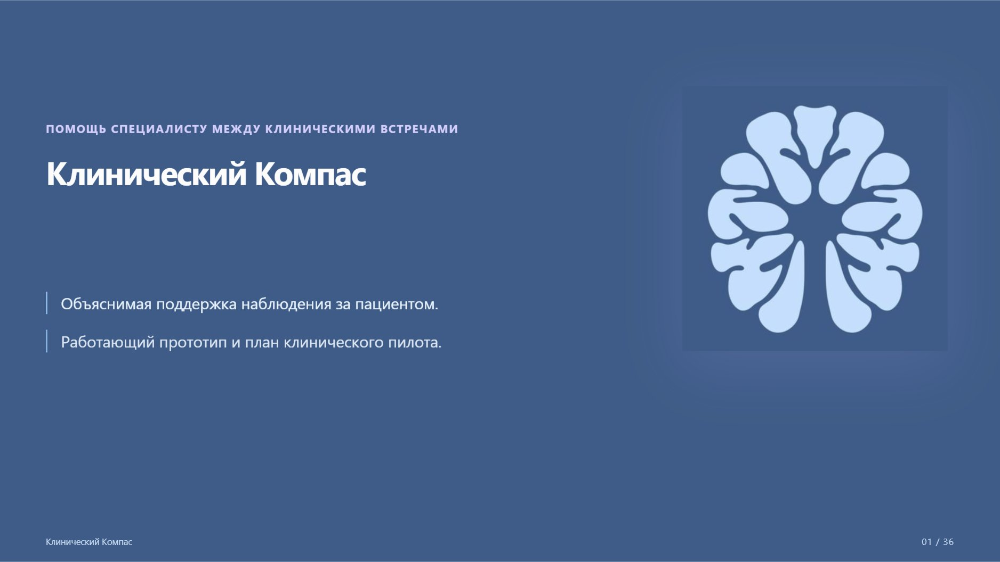
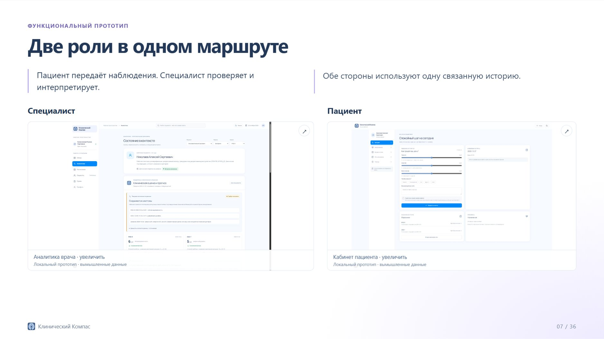
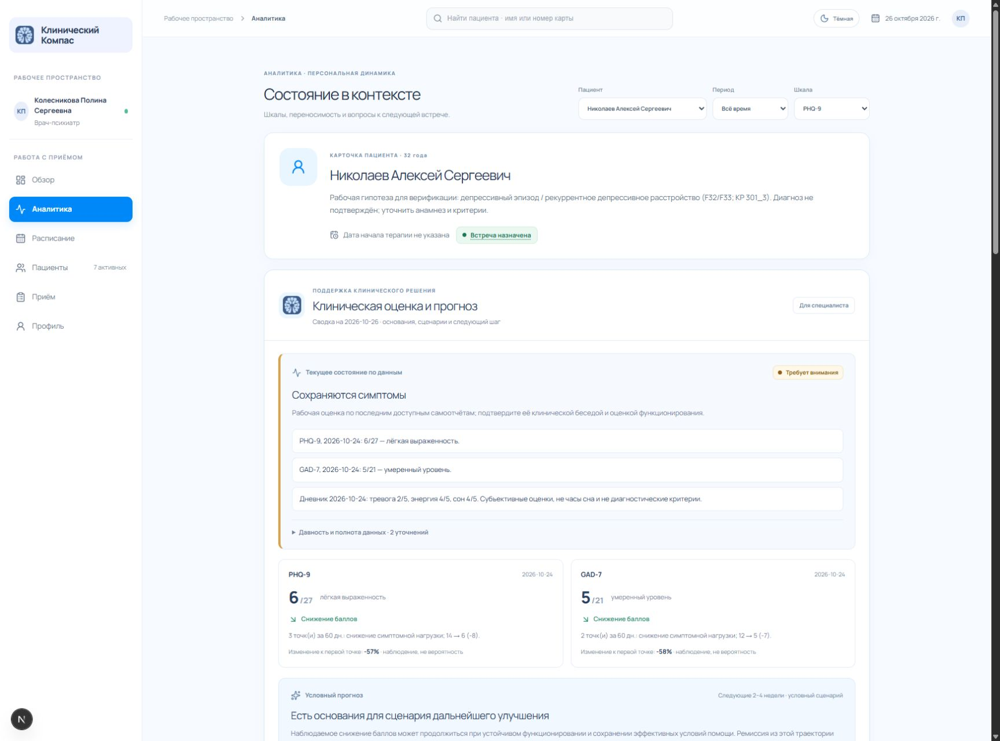
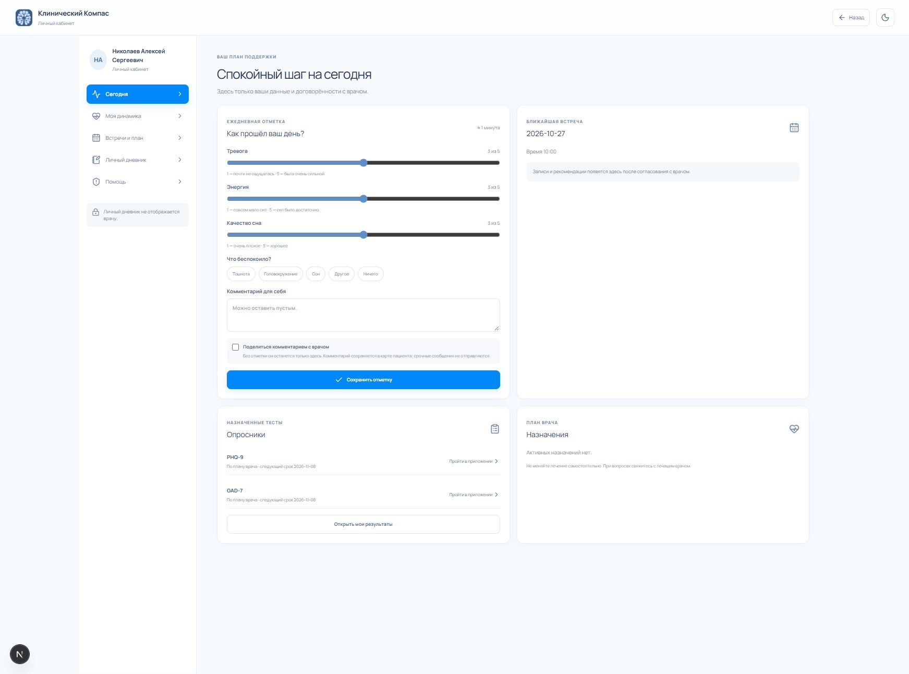
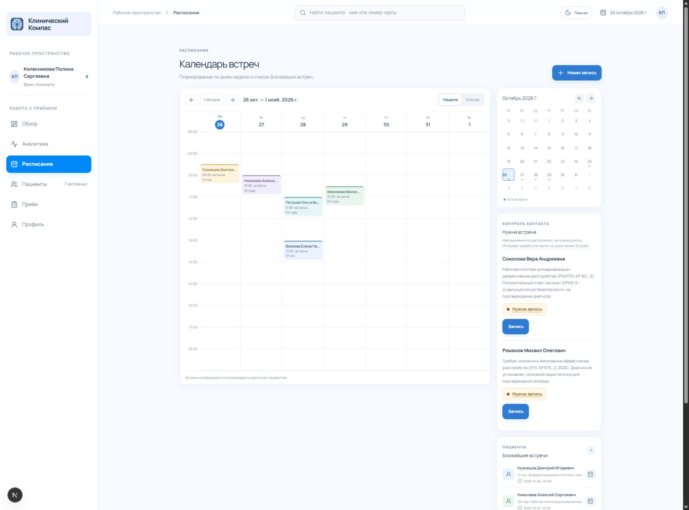
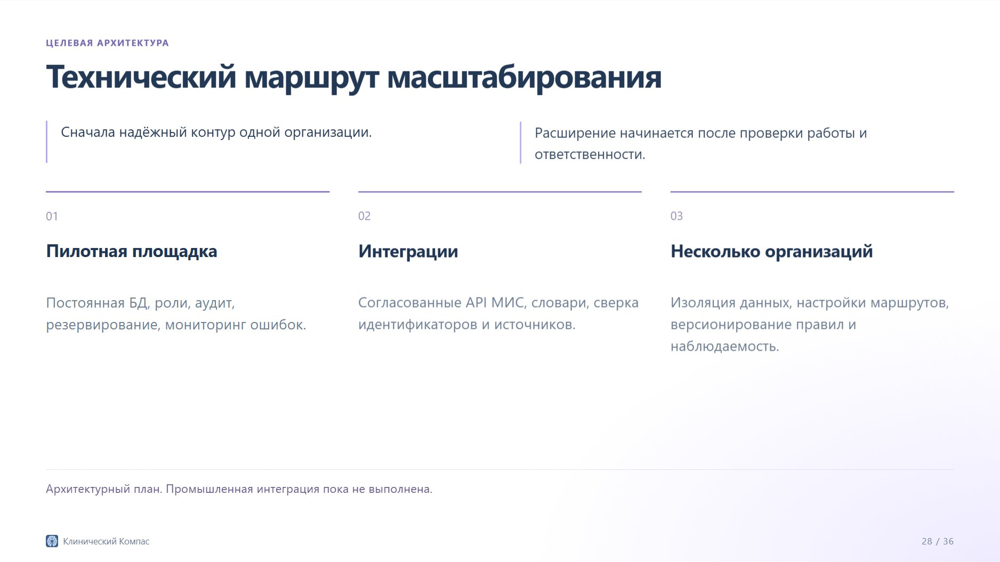

<p align="center"></p>
<h1 align="center">Клинический Компас</h1>
<p align="center">Объяснимая поддержка клинического наблюдения<br>Кабинет специалиста и кабинет пациента</p>
<p align="center"><a href="docs/pitch/clinical-compass-defense.pdf">Презентация</a> · <a href="docs/demo/clinical-compass-demo.mp4">Видео</a> · <a href="docs/physician-support-algorithm.md">Алгоритм</a> · <a href="#запуск">Запуск</a></p>



Клинический Компас помогает специалисту сопоставлять самоотчёты пациента, PHQ-9 и GAD-7, анамнез, функционирование и сведения о терапии. Подсказки раскрывают исходный факт, причину внимания, действие для уточнения и источник.

**Статус:** функциональный демонстрационный прототип. Встроенные карты вымышлены. Клиническая эффективность и сценарный прогноз не прошли внешнюю валидацию. Не используйте публичную демонстрацию для реальных медицинских данных.

## Материалы для защиты

- [Презентация PDF — 30 основных и 6 резервных слайдов](docs/pitch/clinical-compass-defense.pdf).
- [Анимированная презентация для офлайн-показа](docs/pitch/clinical-compass-defense-offline.zip): распакуйте и откройте `index.html`.
- [Видео с русскими титрами, без озвучки](docs/demo/clinical-compass-demo.mp4).
- [Тезисы, слова спикера и ссылки по слайдам](docs/pitch/structure-36-slides.md).
- [Подробный алгоритм со схемами](docs/physician-support-algorithm.md).
- [Алгоритм в Word](docs/Алгоритм%20помощи%20врачу.docx).

Локально анимированная презентация открывается по адресу `http://localhost:3000/pitch/index.html`. Управление: стрелки, `F` — полный экран, `N` — заметки, `G` — обзор.

## Две роли в одном маршруте



**Специалист:** обзор встреч и записей к просмотру, реестр пациентов, карта, интерактивная динамика, исходные ответы, подсказки и запись на следующий контакт.



**Пациент:** назначенные опросники, дневник самочувствия, отметки приёма и нежелательных ощущений, встречи и план. Личный дневник отделён от переданного специалисту комментария.



**Расписание:** организационный светофор показывает отсутствие будущей записи или превышение выбранного интервала после подтверждённой сессии. Его цвет не является оценкой клинической тяжести.



## Как работает алгоритм

1. Получает структурированные записи и дату оценки.
2. Проверяет даты, диапазоны, ответы, версии форм и дубли.
3. Отдельно сохраняет положительный пункт 9 PHQ-9, даже при несогласованной сумме.
4. Рассчитывает сопоставимую динамику каждой шкалы.
5. Сопоставляет симптомы с функционированием и явным контекстом.
6. Формирует подсказки и условные сценарии с объяснением.
7. Специалист проверяет основания, принимает решение и уточняет карту.

Движок `support-0.3.0` детерминирован: одинаковые данные и дата оценки дают одинаковый результат. Дополнительный обзор сочетаний работает отдельно и пока имеет менее строгую временную валидацию.

Изменение балла не является вероятностью ремиссии. Совпадение жалобы и терапии не доказывает лекарственную причинность. Пункт 9 требует прямого уточнения и не заменяет клиническую оценку безопасности.

## Проверки

В наборе 7 вымышленных карт и 15 результатов опросников. Они проверяют ветвления программы, а не служат обучающей или клинической выборкой.

```bash
npm run test:clinical
npx tsc --noEmit
```

На 27.10.2026 успешно выполнены 47 автоматических тестов клинической логики и проверка типов веб-приложения. CI повторяет эти проверки. Основные маршруты дополнительно проверялись в локальном браузере. Клиническое исследование и нагрузочное тестирование не проводились.

## Запуск

Нужны Node.js 22 и npm. Из корня репозитория:

```bash
npm ci
npm run dev
```

Откройте `http://localhost:3000`. На стартовом экране есть демонстрационные входы врача и пациента. Врач может выдать код доступа из вымышленной карты и связать с ней кабинет пациента.

Демонстрационный API работает только в режиме разработки. Данные хранятся в памяти процесса и в браузере. Для демонстрационного сценария используйте `npm run dev`.

## Технологии и структура

- Next.js 16, React 19, TypeScript, Recharts.
- `app/` — веб-интерфейс и демонстрационный API.
- `components/doctor/` и `components/patient/` — два кабинета.
- `lib/clinical-support.ts` — состояние, динамика, сценарии и подсказки.
- `lib/clinical-synthesis.ts` — частичный обзор сочетаний данных.
- `lib/patient-insights.ts` — категории шкал и напоминания.
- `tests/` — автоматические проверки.
- `public/pitch/` — автономная анимированная презентация.
- `docs/` — методология, презентация и видео.
- `mobile/` — отдельный экспериментальный Expo-проект; не входит в проверку типов веб-приложения.

## Источники

- [КР 301_3, редакция 2024](https://apicr.minzdrav.gov.ru/api.ashx?id=301_3&op=GetClinrecPdf).
- [КР 457_3, редакция 2024](https://apicr.minzdrav.gov.ru/api.ashx?id=457_3&op=GetClinrecPdf).
- [PHQ-9, Kroenke et al., 2001](https://pubmed.ncbi.nlm.nih.gov/11556941/).
- [GAD-7, Spitzer et al., 2006](https://pubmed.ncbi.nlm.nih.gov/16717171/).
- [Measurement based care, Zhu et al., 2021](https://www.psychiatrist.com/jcp/measurement-based-care-depression/).
- [Пункт 9, Na et al., 2018](https://pubmed.ncbi.nlm.nih.gov/29477096/).

Актуальность редакций КР перед пилотом требует повторной проверки. Временные окна 7/14/90 дней и условный горизонт сценария — настройки прототипа, а не универсальные сроки из рекомендаций.

## План развития



**До пилота:** единая валидация модулей, история карты, журнал реакции на сигнал, постоянное защищённое хранение, роли и аудит.

**В пилоте:** экспертная оценка подсказок, измерение подготовки к контакту, ошибочных сигналов, нагрузки и участия пациента.

**После проверки пользы:** интеграции с МИС, командное ведение и дополнительные сценарии. Лекарственные базы, NLP и вероятностные модели требуют отдельных источников и валидации.

Реальная интеграция с ЕМИАС, промышленная аутентификация, полный справочник лекарственных взаимодействий, подбор препаратов/доз и автоматическая экстренная доставка уведомлений не реализованы.

## Айдентика

Знак предоставлен автором проекта и используется без перерисовки. Палитра: синий `#3F5C88`, светлый голубой и белый; в презентации — мягкие фиолетовые акценты. [Описание айдентики](docs/brand-identity.md).

Команда проекта: **MedTech Minds**.

