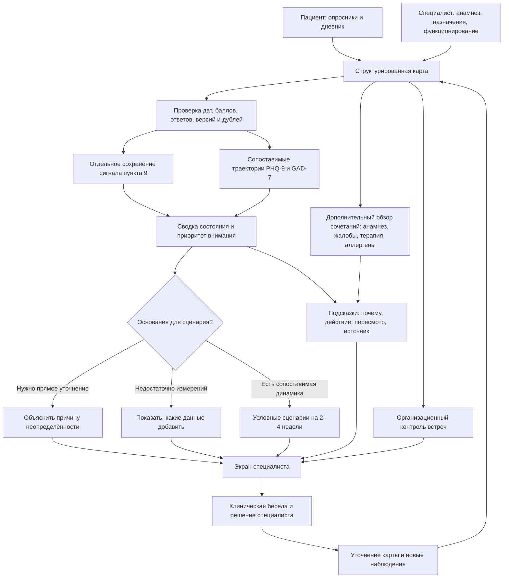
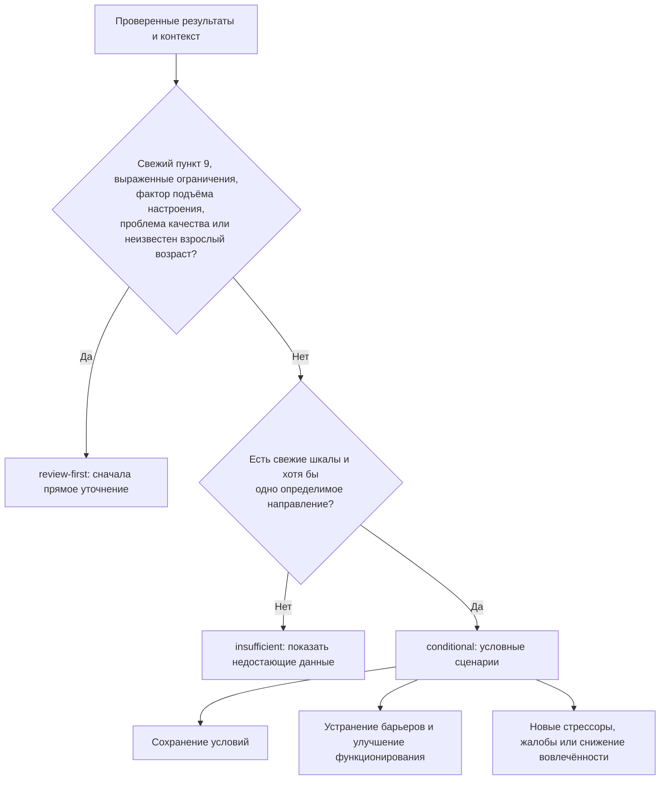
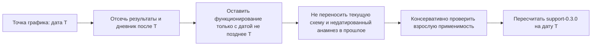
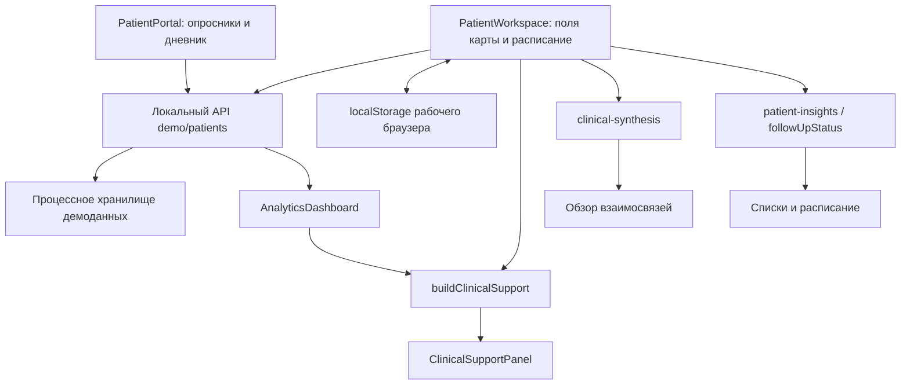

# Клинический Компас: как работает алгоритм помощи врачу

Подробная функциональная и техническая спецификация текущего прототипа. Срез реализации: 26 октября 2026 года.

Основной движок: `support-0.3.0`. Дополнительный обзор взаимосвязей: `demo-review-0.2.0`.

Документ описывает то, что можно проверить в исходном коде. Планируемые возможности выделены отдельно. Под «врачом» далее понимается специалист, принимающий клиническое решение; клинический психолог использует подсказки в пределах своих компетенций и при необходимости организует совместное ведение с психиатром или другим врачом.

## 1. Что делает система

Алгоритм собирает результаты PHQ-9 и GAD-7, дневник пациента, сведения о функционировании, структурированный анамнез и записи о терапии. Затем он проверяет пригодность данных, описывает наблюдаемую динамику, выделяет факты для прямого уточнения и формирует объяснимые подсказки специалисту.

Основная единица результата — не просто цвет или заключение, а цепочка:

**Факт → проверка качества и актуальности → условие правила → объяснение → действие специалиста → условие повторной оценки.**

Например: «Пациент отметил нежелательные ощущения, в карте есть активная терапия → записи требуют сверки → уточнить время начала симптомов, фактический приём и альтернативные причины → обсудить переносимость с назначившим врачом».

Система реализована как детерминированная система поддержки решений: одинаковый вход и одинаковая дата оценки дают одинаковый результат основного движка. Обученная нейросеть, языковая модель и вероятностная модель исходов в этом контуре не используются.

## 2. Общая схема



Дополнительный обзор сочетаний — отдельный модуль со своей логикой проверки. Он пока не проходит через все строгие фильтры основного движка. Схема показывает функциональные потоки, а не наличие единого валидатора для всех модулей.

## 3. Какие данные поступают на вход

### 3.1. От пациента

- **Опросник:** название инструмента, дата, суммарный балл, максимум, исходные ответы, версия формы, отдельный признак положительного пункта 9 PHQ-9.
- **Дневник:** дата, субъективные оценки тревоги, энергии и сна, отметка о приёме терапии, выбранные нежелательные ощущения.
- **Комментарий:** доступен в интерфейсе в зависимости от способа сохранения и передачи. Свободный текст не превращается автоматически в диагностические признаки.

Числовые поля тревоги, энергии и сна в дневнике не являются автоматически часами сна или самостоятельными валидированными диагностическими шкалами. Движок не вычисляет из них диагноз или вероятность осложнения.

### 3.2. От специалиста

- Возраст; ФИО и диагноз/рабочая гипотеза для представления карты.
- Анамнез в свободном тексте и отдельно отмеченные структурированные факторы.
- Аллергологический анамнез и отдельный список веществ для точного сопоставления названий.
- Назначения: название, доза, режим, активность записи.
- Функционирование: дата, степень ограничений, необязательное пояснение.
- Начало терапии, подтверждённые проведённые сессии, будущая запись и индивидуальный интервал организационного контроля.
- Документы и их метаданные.

**Важное различие:** наличие диагноза, анамнеза или файла в интерфейсе не означает, что движок извлекает из них клинические факты. Основная оценка использует явно переданные структурированные поля. Документы не проходят OCR и содержательную автоматическую проверку.

### 3.3. Значение отсутствующих данных

Отсутствие записи означает «неизвестно». Оно не означает «нет симптомов», «нет аллергий», «лекарства не принимает» или «функционирование сохранно».

Примеры:

- Дневник сообщает о приёме, но список активных назначений пуст → требуется сверка фактической терапии.
- Есть дата оценки функционирования, но выбрано «не оценено» → функционирование остаётся неизвестным.
- Нет новой шкалы → текущее состояние требует обновления, а не получает нулевой балл.
- Не заполнено начало терапии → длительность терапии не выводится из даты создания карты.

## 4. Первый этап: проверка пригодности данных

Реализация: `lib/clinical-support.ts`, функция `buildClinicalSupport`.

### 4.1. Даты

Дата должна иметь формат `YYYY-MM-DD`, существовать в календаре и не находиться в будущем относительно даты оценки. Обратная проверка даты отсекает, например, 30 февраля.

Для текущего дня используется локальная календарная дата среды выполнения. Это предотвращает сдвиг на предыдущие сутки при преобразовании московского времени в UTC. Явная единая серверная часовая зона для промышленного контура ещё требует проектирования.

Некорректная дата результата создаёт запись в `dataIssues`, результат исключается. Будущий положительный пункт 9 не выдаётся за уже полученный текущий ответ.

### 4.2. Шкалы и ответы

Для PHQ-9 допустим целый балл 0–27, для GAD-7 — 0–21. Максимум должен соответствовать инструменту.

Если исходные ответы сохранены, проверяются:

1. Ровно 9 ответов для PHQ-9 или 7 для GAD-7.
2. Каждый ответ — целое число от 0 до 3.
3. Сумма ответов равна сохранённому общему баллу.

Если ответы отсутствуют, допустимый суммарный балл может участвовать в описании категории и динамики. При этом восстановить конкретные ответы из суммы нельзя. В частности, отсутствие массива не доказывает отрицательный пункт 9.

### 4.3. Отдельная обработка пункта 9

После проверки даты, но **до отбраковки несогласованного общего балла**, движок сохраняет сигнал, если:

- `item9Positive === true`; или
- девятый ответ PHQ-9 — целое число 1–3.

Это не позволяет ошибке в сумме скрыть исходный положительный ответ. Сам сигнал означает необходимость прямой оценки, а не рассчитанную вероятность суицида. Пункт 9 также не является полным интервью о безопасности.

Для основной сводки сигнал не старше 14 календарных дней включительно считается актуальным по технической настройке. Более старый ответ сохраняется как исторический вопрос для уточнения. **Истечение 14 дней не означает исчезновения риска или завершённой клинической оценки.** В системе пока нет полноценного поля, связывающего сигнал с документированной оценкой и его клиническим разрешением.

### 4.4. Версии форм и дубли

Сначала результаты каждой шкалы сортируются по дате. Для динамики используется последний непрерывный участок одной версии формы.

Пример: `A → A → B → A`. Последняя `A` не соединяется с первыми двумя через `B`: изменённый инструмент разрывает сопоставимый участок.

Если версия отсутствует, она сохраняется как неизвестная. Такая серия может дать предварительное арифметическое описание, но не получает признака более содержательной базы сценария.

Внутри участка берутся результаты за 90 дней перед последней точкой этой шкалы. Для каждой даты:

- Полностью совпадающие балл, ответы и логическое значение признака пункта 9 считаются одной точкой.
- Противоречащие записи исключаются из динамики, а проблема показывается специалисту.
- Если противоречит последний день, шкала не подменяется более старым благоприятным результатом.

Отсутствующий и явно отрицательный сохранённый флаг пункта 9 считаются одинаковыми при дедупликации. Положительный и отрицательный флаги — содержательное противоречие. Наличие противоречия не скрывает отдельно сохранённый положительный сигнал.

## 5. Второй этап: описательная оценка шкал

### 5.1. Категории

PHQ-9:

- 0–4: минимальная выраженность.
- 5–9: лёгкая.
- 10–14: умеренная.
- 15–19: умеренно высокая.
- 20–27: высокая.

GAD-7 в интерфейсе использует терминологию приложения Г2 КР 457_3:

- 0–4: минимальный уровень.
- 5–9: умеренный.
- 10–14: средний.
- 15–21: высокий.

Эти названия описывают суммарный показатель на дату заполнения. Шкала сама по себе не устанавливает диагноз, ремиссию, срочность или эффективность конкретного лечения.

### 5.2. Расчёт изменения

Для каждой шкалы отдельно:

```text
change = последний балл − первый балл
spanDays = последняя дата − первая дата
relativeChange = round(change / первый балл × 100%)
```

Процент рассчитывается только при положительном исходном балле и наличии минимум двух точек. При исходном нуле процент не определён. Баллы PHQ-9 и GAD-7 не складываются в единый показатель.

Например, PHQ-9 `14 → 9 → 6` за 60 дней:

- Изменение: `6 − 14 = −8` баллов.
- Относительное изменение: `−8 / 14 × 100 ≈ −57%`.
- Оба последовательных изменения отрицательные: направление — снижение зарегистрированной симптомной нагрузки.

**−57% — изменение наблюдаемых баллов. Это не вероятность выздоровления, не доказанная эффективность терапии на 57% и не автоматически установленная клинически значимая разница.** Расчёт надёжного изменения с учётом ошибки измерения, MCID и отдельный критерий ответа на терапию сейчас не реализованы.

### 5.3. Выбор направления

Направление определяется при наличии минимум двух разных дат с интервалом не менее 7 дней:

- Все ненулевые изменения вниз → `improving`.
- Все ненулевые изменения вверх → `worsening`.
- Баллы без изменения → `stable`.
- Есть и рост, и снижение между соседними измерениями → `mixed`.
- Точек или интервала недостаточно → `insufficient`.

Пример `14 → 5 → 8` получает «колебания», хотя последний балл ниже первого. Такой подход не скрывает промежуточное ухудшение за общим отрицательным изменением.

При объединении свежих направлений шкал:

- Смешанная серия или противоположные направления PHQ-9/GAD-7 → смешанная динамика.
- Рост одной шкалы при стабильной другой → рост.
- Снижение одной при стабильной другой → снижение.
- Только стабильные направления → стабильность.
- Все направления неизвестны → недостаточно данных.

Шкала с недостаточным числом точек не задаёт направление; направление другой свежей шкалы может использоваться. Устаревшая серия исключается из общего направления прогноза.

## 6. Третий этап: дневник и функционирование

### 6.1. Дневник в основном движке

Используются записи с корректными небудущими датами; для текущей сводки — не старше 14 дней от даты оценки.

Нежелательными ощущениями считаются непустые варианты, кроме «Ничего». Это самоотчёт о жалобах, а не подтверждённая нежелательная лекарственная реакция.

Отметки `missed` и `side-effect` учитываются как затруднения приёма. Значения `yes`, `late`, `missed`, `side-effect` показывают, что пациент сообщил контекст терапии. Если при этом нет активных назначений, появляется отдельный пробел «сверить схему».

Одновременный выбор «Ничего» и конкретной жалобы создаёт проблему качества данных. Он не интерпретируется как отсутствие нежелательных ощущений.

### 6.2. Функционирование

Специалист отдельно выбирает `none`, `mild`, `moderate` или `severe` и указывает дату. `not-assessed` не участвует как оценка сохранного функционирования.

В текущей сводке учитывается оценка не старше 14 дней с корректной датой. Свежие лёгкие/умеренные ограничения не позволяют общей сводке стать зелёной только из-за низких баллов. Выраженные ограничения создают приоритет прямой оценки.

Содержание заметки не классифицируется автоматически. Алгоритм не выводит степень ограничения из слов пациента без структурированного выбора специалиста.

## 7. Как формируется светофор состояния

Светофор показывает основание для внимания и дальнейшего уточнения. Красный цвет не является единой категорией неотложности: он может обозначать положительный пункт 9, выраженное ограничение функционирования или высокий балл. Конкретное основание написано рядом.

Приоритет выбора **цвета** в `support-0.3.0`:

```text
1. Свежий положительный пункт 9 ИЛИ выраженное функционирование → красный.
2. Иначе взрослый возраст не подтверждён → нейтральный.
3. Иначе есть свежий балл любой шкалы ≥15 → красный.
4. Иначе есть свежие лёгкие/умеренные ограничения функционирования → жёлтый.
5. Иначе нет свежих пригодных шкал → нейтральный.
6. Иначе есть балл ≥5, жалобы, затруднения приёма, фактор подъёма
   настроения, проблема качества или неизвестная схема при сообщённом приёме → жёлтый.
7. Иначе → зелёный: низкие баллы по заполненным свежим шкалам.
```

При неизвестном/несовершеннолетнем возрасте сигнал пункта 9 и выраженные ограничения не скрываются. При этом взрослые рекомендации по психологическому вмешательству не применяются автоматически.

Заголовок, цвет, объяснение и список подсказок формируются отдельно. Например, при высоком балле и умеренном ограничении заголовок может выделять функционирование, а цвет оставаться красным из-за балла. Интерфейс должен позволять увидеть оба основания.

**Нейтральный — недостаток применимых сведений. Зелёный — низкая зарегистрированная симптомная нагрузка в доступных шкалах. Ни один из них не означает доказанную безопасность.** Исторический пункт 9 может сохраняться в отдельных подсказках даже при зелёной сводке; он сам по себе не повышает цвет текущего состояния.

## 8. Как работает условное прогнозирование

Это описание возможных сценариев по наблюдаемой динамике. Движок не вычисляет индивидуальную вероятность исхода и не предсказывает будущий балл.



### 8.1. Три режима

**`review-first`.** Есть приоритетный сигнал, анамнез подъёма настроения/активности, проблема качества или не подтверждена взрослая применимость. Возвращается объяснение, почему сценарий зависит от уточнения; три сценарные карточки не создаются.

**`insufficient`.** Нет свежей пригодной шкалы или невозможно определить направление. Система предлагает добавить повторное сопоставимое измерение и данные беседы/функционирования.

**`conditional`.** Есть направление без перечисленных блокирующих условий. На горизонт 2–4 недели показываются:

1. Сохранение условий и сопоставимого измерения: возможно продолжение зарегистрированного направления.
2. Улучшение функционирования и устранение барьеров: возможно более устойчивое улучшение.
3. Новые стрессоры, затруднения терапии или снижение вовлечённости: возможно ухудшение, включая случай предшествующего снижения баллов.

### 8.2. Объём оснований

Более содержательная описательная база отмечается, только если **каждая имеющаяся траектория** содержит минимум 3 точки, охватывает минимум 14 дней, имеет свежий последний результат и указанную версию формы.

Не требуется обязательное наличие обеих шкал: если есть только одна, проверяется она. Устаревшая вторая траектория не меняет направление свежей первой, но не позволяет объявить всю базу более содержательной.

Этот признак не является статистической уверенностью, доверительным интервалом или доказанной точностью. Отсутствие оценки функционирования само по себе не блокирует сценарий, но явно показывается как неизвестный контекст.

### 8.3. Почему здесь нет процентов вероятности

Байесовская запись `P(исход | данные)` требует определённого исхода, горизонта, исходной частоты, репрезентативных наблюдений, правил обработки пропусков и проверки калибровки на независимых пациентах. В прототипе этих оснований нет.

Семь синтетических карт позволяют проверить ветвления программы, но не оценить частоту ремиссии, рецидива или лекарственной реакции. Поэтому текущий прогноз качественный и условный. Полный перебор всех медицинских сочетаний не реализован; поддерживается конечный проверяемый набор правил.

## 9. Каталог подсказок основного движка

Каждая подсказка содержит `id`, `priority`, `title`, `reason`, `action`, `reassess`, `sourceIds`.

1. **`safety` — прямая оценка безопасности.** Триггер: положительный пункт 9 за последние 14 дней. Действие: уточнение актуальных мыслей, намерений, плана, доступа к средствам, прошлых эпизодов и поддержки; при непосредственной опасности — экстренная медицинская оценка по локальному протоколу. Приложение не сообщает, что помощь уже организована.
2. **`severe-function` — выраженные ограничения.** Триггер: свежая степень `severe`. Уточняются самообслуживание, поддержка и потребность в совместной медицинской помощи; фактическая срочность определяется прямой оценкой.
3. **`historical-safety` — исторический ответ.** Триггер: положительный пункт 9 есть, свежего нет. Уточнить актуальность при контакте и документировать оценку; не объявлять прошлый ответ текущей неотложностью.
4. **`activation` — эпизоды подъёма настроения.** Триггер: точная структурированная отметка в анамнезе. Уточняются эпизодичность, длительность, потребность во сне, последствия и вещества; при соответствующем подозрении обсуждается оценка психиатром. Свободный текст автоматически не распознаётся.
5. **`depression-plan` — план психологической помощи.** Взрослый возраст и свежий PHQ-9 ≥5. Обсудить формулировку случая, психообразование, согласованные цели и применимость КПТ/интерперсонального подхода с учётом подготовки специалиста и предпочтений пациента.
6. **`anxiety-plan` — мишени работы с тревогой.** Взрослый возраст и свежий GAD-7 ≥5. Уточнить триггеры, избегание, функционирование; обсудить подходящие психологические методы.
7. **`tolerability` — переносимость.** Взрослый возраст и свежие жалобы/затруднения приёма. Сверить фактическую схему, хронологию, альтернативные причины; согласовать обсуждение с назначившим врачом.
8. **`regimen-context` — отсутствует действующая схема.** Взрослый возраст, пациент сообщает приём, активных назначений нет. Уточнить средства и назначившего врача до причинных выводов о динамике.
9. **`medical-review` — совместное ведение.** Взрослый возраст и свежий балл любой шкалы ≥15. Сопоставить беседу, функционирование и баллы; обсудить медицинскую оценку по клинической необходимости. Порог сам по себе не определяет срок контакта.
10. **`functioning` — дополнить оценку жизни.** Нет свежей пригодной оценки функционирования. Уточнить работу/учёбу, отношения, самообслуживание и цели.
11. **`maintain-gains` — закрепить изменения.** Взрослый возраст, общее направление улучшается и нет режима `review-first`. Обсудить полезные навыки, ранние признаки ухудшения и план действий. Не завершать наблюдение только по низкому баллу.
12. **`refresh` — обновить оценку.** Нет свежих пригодных шкал. Повторить сопоставимую оценку и клиническую беседу; сохранить старые данные как историю.

Несколько подсказок могут сработать одновременно. Они не исключают друг друга и не образуют автоматически назначенный план лечения. Их порядок в массиве задаётся порядком правил в коде; отдельного численного рейтинга всех клинических задач нет.

## 10. Обзор взаимосвязей анамнеза, симптомов и терапии

Реализация: `lib/clinical-synthesis.ts`. Этот модуль возвращает `signals`, `missingContext`, сведения о просмотренных инструментах и количестве документов. Область покрытия обозначена `partial`.

Он собирает вопросы для проверки причинности специалистом. Главный принцип: **совпадение записей или дат даёт гипотезу для уточнения, а не доказательство причины.**

### 10.1. Реализованные сочетания

- **Пункт 9 PHQ-9:** положительный исходный ответ/флаг → прямой просмотр. В этом модуле исторические записи не разделены по 14-дневному окну, как в основном движке.
- **Изменение балла:** первый и последний результат одного инструмента → арифметическое сравнение и предложение сверить форму, условия, функционирование. Строгая сегментация версий основного движка здесь не применяется.
- **Неполная схема:** у активной записи пустая доза или режим → сверить назначения. Строка-заглушка «не заполнена» сама по себе не распознаётся как пустое поле.
- **Документы с сомнительной маркировкой источника:** метаданные содержат признаки демо/симуляции/ручного или неподтверждённого ввода → проверить происхождение. Это проверка метаданных, а не содержимого файла.
- **Последний дневник и затруднение приёма/жалоба:** открыть фактический препарат, время появления симптомов и причины пропуска.
- **«Ничего» вместе с жалобой:** уточнить противоречивый исходный ответ.
- **Активное назначение совпадает с веществом аллергии:** точное нормализованное название → прямой просмотр МНН, характера прошлой реакции и фактического приёма.
- **Жалоба + активная терапия:** проверить хронологию, изменение дозы, соматические причины и другие средства. Совместное присутствие не доказывает нежелательную лекарственную реакцию.
- **Жалоба без активной схемы:** собрать полный фактический список, включая безрецептурные средства.
- **Минимум две отметки `missed`/`side-effect`:** в 14-дневном окне перед последним дневником → обсудить переносимость, доступность и понимание схемы. Это не доказательство неэффективности лечения.
- **Рост шкалы + жалоба/пропуск:** последний балл выше предыдущего при одинаковом максимуме; в пределах 7 дней до результата, включая сам день, есть соответствующий дневник → проверить временную последовательность и альтернативные объяснения.
- **Структурированный анамнез:** вывести явно отмеченные факторы как вопросы для сопоставления с симптомами и терапией.
- **Дневник приёма без схемы:** последнее значение отличается от `not-set`, активных назначений нет → сверить карту. Отсутствие записи о препарате не равно отсутствию лечения.
- **Повторяющееся название активного назначения:** проверить, это дублирование записи или части схемы. Суммарная доза не вычисляется.
- **Жалобы + структурированный соматический фактор:** проверить соматическое состояние и все лекарства; не объяснять жалобу автоматически тревогой или терапией.
- **Беременность/лактация + активное назначение:** уточнить статус и отдельно сверить каждое средство с профильными источниками. Автоматического вывода о противопоказании нет.
- **Контекст демонстрационного случая:** вывести заранее внесённые сведения для обсуждения. Это исходная информация сценария, а не вновь обнаруженный машиной медицинский факт.

### 10.2. Как устроено сопоставление аллергии

Название нормализуется: обрезаются крайние пробелы, регистр приводится к нижнему, `ё` заменяется на `е`. Далее используется точное равенство с отдельно внесёнными веществами `allergySubstances`. Учитываются только активные назначения.

Не реализованы автоматическое выделение аллергенов из свободного текста, торговые синонимы, состав комбинированных средств, перекрёстная аллергия и градация тяжести реакции. Запись «аллергии отрицает» не разбирается языковой моделью. Свободный текст без структурированных веществ требует ручной сверки.

### 10.3. Различия, которые нельзя скрывать

Основной движок оценивает свежесть относительно **даты текущей оценки**. В дополнительном обзоре окно повторных пропусков отсчитывается от **последнего дневника**. Поэтому старый кластер записей может породить вопрос в обзоре и не участвовать как свежая жалоба в текущей сводке.

Дополнительный обзор пока не использует весь набор строгих проверок дат, ответов, конфликтов и версий основного движка. Приоритет `direct-review` здесь — просьба открыть исходные данные, а не автоматически подтверждённая текущая неотложность.

Объединение валидаторов и единой временной политики — необходимый следующий этап. До него два блока следует читать по их пояснениям, а не считать равнозначными оценками текущего состояния.

## 11. Отдельный светофор расписания

Реализация: `followUpStatus` в `lib/patient-insights.ts`.

Этот светофор отвечает на вопрос «организован ли следующий контакт и не превышен ли выбранный интервал?». Он не оценивает тяжесть заболевания.

1. Найти последнюю корректную дату реально проведённой сессии из `sessions` и `lastSessionDate`, исключив будущие даты.
2. Взять индивидуальный положительный `followUpDays`; если его нет — техническое значение 30 дней.
3. Определить, есть ли предстоящая запись. Будущая дата подходит; сегодняшняя — если время ещё не прошло. Для сегодняшней записи без корректного времени считается, что контакт ещё ожидается.
4. Если с последней подтверждённой сессии прошло **больше** интервала → красный «Перерыв N дней», даже если следующая встреча уже назначена.
5. Иначе будущей записи нет → жёлтый «Нужна запись».
6. Иначе → зелёный «Встреча назначена».

Ровно 30 дней при интервале 30 не считается превышением. Прошедший слот календаря не подтверждает состоявшуюся сессию. Если история сессий неизвестна, длительный перерыв не выдумывается: пробел показывается словами.

Значение 30 дней — организационная настройка, а не медицинская рекомендация о допустимом интервале для всех пациентов.

## 12. Что происходит при нажатии на точку графика

В аналитике специалист открывает конкретный результат: дату, балл, исходные ответы и пояснения. Для исторической сводки используется `clinicalSnapshotAt`.



Исторический расчёт не должен «знать будущее». Текущий список лекарств не доказывает, что пациент принимал их в день прошлого теста. Недатированный анамнез тоже не реконструирует прошлый контекст.

Точный возраст в прошлом без даты рождения неизвестен. В коде используется консервативная нижняя оценка: текущий возраст минус округлённое вверх число прошедших лет. Если даже она не подтверждает 18 лет, взрослая применимость остаётся неизвестной. Это техническая защита, а не восстановление даты рождения.

## 13. Как специалист работает с результатом

1. Открывает карту и проверяет ФИО, даты, актуальность и источник данных.
2. Просматривает приоритетные основания: пункт 9, функционирование, высокую нагрузку, качество данных.
3. Нажимает на исходный результат и при необходимости сверяет ответы.
4. Читает каждую подсказку в формате «почему → что уточнить → когда пересмотреть → источник».
5. Сопоставляет её с беседой, анамнезом, соматическим состоянием, фактической терапией и контекстом жизни.
6. Принимает решение, уточняет карту, назначает следующий контакт или организует совместное ведение.
7. После новых данных повторно оценивает динамику.

В текущем прототипе нет полноценного журнала принятия/отклонения каждой подсказки с подписью, причиной и историей версий. Само наличие карточки или открытие результата не означает, что специалист уже оценил и разрешил сигнал.

## 14. Техническая архитектура



Ключевые файлы:

- `lib/clinical-support.ts`: проверка входа, состояние, траектории, сценарии, подсказки и источники.
- `lib/clinical-synthesis.ts`: дополнительный обзор сочетаний и неизвестного контекста.
- `lib/patient-insights.ts`: категории отдельных результатов, расписание, длительность терапии и вспомогательные функции.
- `components/doctor/ClinicalSupportPanel.tsx`: представление основного результата.
- `components/doctor/AnalyticsDashboard.tsx`: график и исторический просмотр.
- `components/doctor/PatientWorkspace.tsx`: карта и действия специалиста.
- `components/patient/PatientPortal.tsx`: путь пациента.
- `app/api/demo/patients/route.ts`, `lib/demo-store.ts`: локальный демонстрационный обмен и хранение.
- `lib/psychiatric-demo-cases.ts`: синтетические случаи.

В демонстрации используется локальный API, процессное серверное состояние и локальное браузерное сохранение. Настоящая интеграция с ЕМИАС, промышленная база данных, надёжная авторизация, разграничение доступа и медицинский аудит в этом виде не реализованы. Метка симуляции интеграции не означает реальный обмен с медицинской информационной системой.

### 14.1. Отдельный механизм публикации правил

В `lib/clinical-rules.ts` есть универсальный вычислитель декларативных правил: `all`, `any`, `not`, `some`, `exists`, сравнения и включение в набор.

Для активного правила он требует заполненные поля врачебного утверждения и источника, затем проверяет наличие обязательных фактов и условие. Возвращает сработавшие правила, неизвестный контекст и недоступные правила.

**Этот механизм пока не подключён к основному клиническому экрану как действующий каталог правил.** Подсказки `support-0.3.0` формируются непосредственно в коде и не проходят этот шлюз публикации. Проверка заполненности `approvedBy` также не является электронной подписью или технической проверкой полномочий утвердившего лица.

Для промышленной версии нужно соединить каталог, управление версиями, реальное врачебное утверждение и движок исполнения; нельзя уже сейчас заявлять, что каждое отображаемое правило прошло такой процесс.

## 15. Контракт результата и объяснимость

Основной результат имеет следующую структуру:

```text
ClinicalSupport
├── version / asOf              версия алгоритма и дата оценки
├── state
│   ├── tone / title / summary  приоритет внимания и пояснение
│   ├── freshness              правило актуальности
│   ├── evidence[]             факты, на которых основана сводка
│   └── unknowns[]             недостающий контекст
├── trajectories[]             отдельные сопоставимые шкалы
├── forecast
│   ├── kind                   review-first / insufficient / conditional
│   ├── basis / horizon        основания и условный горизонт
│   └── scenarios[]            условия и возможное развитие
├── advice[]                   причина, действие, пересмотр, ссылки
├── sources[]                  реестр используемых источников
└── dataIssues[]               исключённые или противоречивые сведения
```

Такой контракт позволяет объяснить результат без доступа к внутреннему «чёрному ящику». Однако неизменяемый снимок входа, контрольная сумма и полноценный журнал того, какой результат видел специалист в момент решения, ещё не сохраняются автоматически.

## 16. Разбор демонстрационных случаев

Все имена и карты ниже вымышлены. Базовый набор содержит **7 карт и 15 результатов опросников**. Ожидаемые выводы приведены на фиксированную дату **26.10.2026**: при другой дате свежесть изменится.

### Случай 1. Снижение симптомов с пробелом в схеме

Николаев Алексей Сергеевич, 32 года. PHQ-9: `14 → 9 → 6`; GAD-7: `12 → 5`. Последние результаты — 24.10.2026.

Движок показывает снижение обеих шкал. По PHQ-9: −8 баллов, −57%; по GAD-7: −7 баллов, −58%. Условный сценарий улучшения возможен, но не означает ремиссию. Для более содержательной базы не хватает третьей точки GAD-7.

В дневнике сообщается приём, активная схема отсутствует. Поэтому сводка остаётся жёлтой, добавляется сверка фактического лечения. Функционирование также требует отдельной оценки. Исходный код не устанавливает, какая терапия вызвала снижение.

### Случай 2. Положительный пункт 9

Соколова Вера Андреевна, 27 лет. PHQ-9: `19 → 21`, положительный пункт 9 в двух прохождениях, последнее — 25.10.2026.

Красный приоритет прямой оценки, прогноз `review-first`, отдельная подсказка по безопасности. Приложение не рассчитывает процент риска и не утверждает, что специалист или экстренная служба уже уведомлены.

### Случай 3. Высокая тревожная нагрузка

Кузнецов Дмитрий Игоревич, 41 год. GAD-7: `17 → 16`; PHQ-9: одна точка 11.

Высокий свежий GAD-7 даёт красный цвет по выраженности. Снижение на 1 балл — описательный факт; это не доказанная клинически значимая эффективность. Для PHQ-9 направления нет. Сценарий по доступной тревожной динамике может быть условным и предварительным; высокий балл сам по себе не включает режим `review-first`. Телесные эпизоды из описания остаются предметом клинического уточнения.

### Случай 4. Анамнез подъёма активности

Романов Михаил Олегович, 30 лет. PHQ-9 =7, явно отмечен фактор подъёма настроения/активности.

Сводка жёлтая, прогноз зависит от клинического уточнения. Подсказка предлагает уточнить эпизодичность, сон, последствия и вещества. Низкий относительно максимума PHQ-9 не исключает другую клиническую картину. Сам диагноз БАР алгоритм не устанавливает.

### Случай 5. Соматический контекст

Петрова Ольга Викторовна, 54 года. PHQ-9 =10, GAD-7 =9, соматический фактор, запись терапии с текстовыми заглушками.

Жёлтая симптомная нагрузка; по одной точке каждой шкалы недостаточно динамики для сценария. Соматический анамнез выводится в вопросах для сопоставления. Отдельное правило «жалобы + соматический фактор» сработает лишь при наличии жалоб дневника; в исходной карте дневник пуст. Заглушка дозы требует ручной проверки, поскольку программная проверка ловит пустую строку, а не её клиническую информативность.

### Случай 6. Устаревшие результаты

Волкова Елена Павловна, 37 лет. Последние шкалы — 20.09.2026.

Основная сводка нейтральная: текущие сведения нужно обновить. Исторические баллы сохраняются. Просрочка заполнения не доказывает ухудшение, выздоровление или отказ от помощи.

### Случай 7. Первичная неполная карта

Морозова Ирина Александровна, 62 года. Нет исходных шкал и достаточного анамнеза.

Сводка нейтральная, сценарий недостаточен. Система помогает собрать данные, не создавая диагноз или зелёный статус из пустой карты.

### Дополнительный пример взаимосвязи

Это иллюстрация правила, не восьмая базовая карта: у пациента рост PHQ-9, дневник с пропуском за 3 дня до результата и жалоба на тошноту.

Допустимый вывод системы: «Рост балла и отметки о переносимости/пропуске в близкие даты. Уточнить последовательность, реальные препараты, стрессоры и соматические причины».

Недопустимый вывод из этих данных: «Препарат вызвал ухудшение с вероятностью 80%». Ни причинность, ни такой процент текущим модулем не вычисляются.

## 17. Параметры алгоритма: откуда они взялись

Следующие значения — настройки авторской реализации:

- 14 дней: свежесть шкал, дневника и функционирования в основной сводке.
- 90 дней: глубина сопоставимой серии перед её последним результатом.
- 2 точки и ≥7 дней: минимум для описания направления.
- 3 точки, ≥14 дней, известная форма и свежесть: более содержательная описательная база.
- 2–4 недели: условный горизонт сценария.
- 7 дней до результата: окно сопоставления роста балла и дневника в дополнительном обзоре.
- 14 дней перед последним дневником: окно повторных затруднений приёма дополнительного обзора.
- 30 дней: резервный организационный интервал между подтверждёнными встречами.

Эти интервалы не выдаются за универсальные сроки из клинических рекомендаций. Их следует проверять и настраивать в пилоте с клинической командой. Категории суммарных шкал имеют отдельную источниковую основу; их нельзя смешивать с авторскими окнами свежести и прогнозирования.

## 18. Источники и их применение

В проектной документации зафиксировано получение полных текстов 26.10.2026. Настоящий документ сверяет реализацию с уже внесёнными источниками; отдельная повторная проверка новизны редакций в рамках подготовки этого файла не проводилась.

1. **Минздрав РФ. «Депрессивный эпизод, рекуррентное депрессивное расстройство», КР 301_3, редакция 2024.** [Полный PDF](https://apicr.minzdrav.gov.ru/api.ashx?id=301_3&op=GetClinrecPdf). Используемые в коде ссылки: §2.1, стр.16–18; §3.7, стр.46–50; §4–5, стр.53–55. Основания для клинической оценки, обсуждения психологической помощи и наблюдения.
2. **Минздрав РФ. «Генерализованное тревожное расстройство», КР 457_3, редакция 2024.** [Полный PDF](https://apicr.minzdrav.gov.ru/api.ashx?id=457_3&op=GetClinrecPdf). §2.1, стр.12–14; §3.3, стр.32–37; приложение Г2, стр.86–87. Основания для уточнения тревожной картины, психологических методов и выбранной терминологии GAD-7.
3. **Kroenke K. et al., 2001. The PHQ-9: validity of a brief depression severity measure.** [PubMed](https://pubmed.ncbi.nlm.nih.gov/11556941/). Источниковая база PHQ-9 и категорий выраженности.
4. **Spitzer R. L. et al., 2006. A brief measure for assessing generalized anxiety disorder: the GAD-7.** [PubMed](https://pubmed.ncbi.nlm.nih.gov/16717171/). Исходное исследование инструмента; дополнительная методологическая ссылка, не отдельный `sourceId` текущего движка.

Редакции 301_3 и 457_3 здесь нельзя называть «клиническими рекомендациями редакции 2026 года». Отдельно не подтверждено, что на дату применения отсутствуют более новые редакции. Ссылки на КР обосновывают клиническое содержание, но не подтверждают авторские сценарные правила и их точность.

Сценарные описания в демонстрационных картах могут упоминать другие диагнозы/КР. Это не означает, что для них уже реализованы полноценные диагностические или лечебные алгоритмы.

## 19. Что проверено тестами

При подготовке документа повторно выполнено:

```powershell
npm run test:clinical
```

Результат: **47 тестов, 47 успешных, 0 ошибок**. Файлы: `tests/clinical-support.test.cjs` и `tests/patient-insights.test.cjs`.

Проверяются:

- Корректность дат, исключение будущих/невозможных результатов и локальный день.
- Граница свежести: 14 дней включительно и истечение после неё.
- Целые баллы, диапазоны, максимумы, длина и сумма ответов.
- Сохранение пункта 9 при низком или повреждённом общем балле; отдельная обработка исторического ответа.
- Дубли, конфликты последнего дня и нормализация отсутствующего/отрицательного флага.
- Смена версии, возврат A→B→A и неизвестная форма.
- Сортировка по дате, противоположные шкалы, колебания внутри серии, недостаточный интервал.
- Неоценённое, устаревшее и выраженное функционирование; запрет зелёного по низкому баллу при свежих ограничениях.
- Возрастная применимость, противоречия дневника и отсутствие схемы при сообщённом приёме.
- Исторический срез без будущих результатов и без переноса текущих лекарств/недатированного анамнеза в прошлое.
- Объяснения и разрешимые ссылки на источники.
- Напоминания по проведённым сессиям и будущим записям; явная дата начала терапии.
- Точное сопоставление аллергенов, повторные названия препаратов и допустимое временное окно сочетаний.

Тесты проверяют программные инварианты. Они не измеряют диагностическую точность, чувствительность, специфичность, снижение числа осложнений или калибровку прогноза. На синтетических данных такие клинические показатели не заявляются. Отдельного подтверждения полного покрытия всех правил, промышленной нагрузки или внешней клинической валидации нет.

## 20. Что уже работает и что нужно развивать

### Уже реализовано

- Объяснимая сводка доступных данных с отдельными неизвестными и проблемами качества.
- Проверка основных шкал и сопоставимости траекторий.
- Выделение пункта 9, функционирования и структурированного фактора подъёма активности.
- Условные сценарии и предметные рекомендации специалисту.
- Частичный обзор сочетаний дневника, анамнеза, назначений и аллергенов.
- Организационные напоминания и исторический просмотр результата.
- Автоматические проверки перечисленных программных инвариантов.

### Следующий этап: единый клинический контур

1. Объединить строгие валидаторы и временные правила всех модулей; явно разделить текущие и исторические сигналы.
2. Версионировать анамнез, назначения, функционирование и оценки безопасности с датой события, датой внесения и источником.
3. Добавить журнал решения специалиста по сигналу: просмотрено, уточнено, план согласован, основание, ответственный, срок повторного контакта. Исчезновение записи из окна свежести не должно заменять клиническое закрытие задачи.
4. Связать исполняемые правила с проверяемым каталогом источников, реальным утверждением, историей изменений и тестовыми примерами.
5. Для лекарственных проверок подключать проверенный справочник МНН/составов/инструкций и отдельный проверенный механизм взаимодействий. Точное равенство названий недостаточно для такого заявления.

### Следующий этап: внедрение и масштабирование

1. Постоянное защищённое хранилище, аутентификация, роли, аудит, резервирование и подтверждённый обмен с медицинскими системами.
2. Клинический пилот: заранее определить сценарии применения, допустимые формулировки, порядок реагирования и ответственных.
3. Проверить полезность и нагрузку: доля подтверждённых подсказок, пропущенные значимые случаи, ложные сигналы, время проверки, понятность объяснений и влияние на рабочий процесс.
4. Отдельно оценить работу в подгруппах, при пропусках данных, смене формы, соматических состояниях и неполном анамнезе. Детский контур требует собственной разработки.
5. Версионировать пороги и проводить регрессионную проверку перед каждым выпуском.

### Если развивать числовой прогноз

Потребуются заранее определённый клинический исход и горизонт, законно собранная репрезентативная выборка, разметка исходов, разделение по пациентам и времени без утечки будущего, внешняя проверка и калибровка. Только после этого можно обсуждать индивидуальные вероятности и их интервалы неопределённости. Такая модель будет отдельным валидируемым компонентом, а не переименованием текущей сценарной логики.

## 21. Краткая формулировка для презентации

«Клинический Компас превращает разрозненные данные наблюдения в объяснимые вопросы и действия для специалиста. Алгоритм проверяет качество и давность измерений, показывает динамику, сопоставляет симптомы с анамнезом и терапией и объясняет основание каждой подсказки. Специалист проверяет её в беседе, принимает решение и уточняет карту; новые данные запускают следующий цикл оценки».

## 22. Связанные документы

- [Краткая спецификация support-0.3](clinical-support-0.3.md).
- [Предыдущий каталог обзора взаимосвязей](doctor-support-algorithms.md).
- [Реестр клинических источников](clinical-guideline-registry.md).
- [Структура презентации из 15 слайдов](pitch/structure-15-slides.md).

Этот документ фиксирует устройство прототипа, включая ограничения текущего кода. Изменение правил, источников или структуры входа требует обновления спецификации и повторной проверки соответствующих сценариев.
